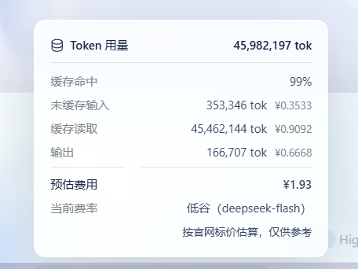

# dsh-cost-pill

在 DSH 输入框旁的胶囊区多显示一个只读胶囊：本次会话到目前为止花了多少钱（人民币）。


*桌面端实际效果：费用接在 Token 用量与缓存命中的后面，同一行同一样式。*


*用本仓库自己的 `lib/client.js` 渲染，token 数据为示例值。*

## 显示什么

`· 费用 ¥0.0871` —— 会话已计费 token 的估算费用。鼠标悬停可看到构成这个数字的明细：

```
费用 ¥0.0871 · 高峰 · deepseek-flash
未缓存输入 ¥0.0557 · 缓存读取 ¥0.0055 · 输出 ¥0.0259
按官网标价估算
```

会话还没有产生任何计费 token 时不显示。

## 用量弹窗里的明细

宿主自己的 Token 用量弹窗只给计数、不给金额。插件在弹窗打开时，为每个分项补上对应金额，
并在末尾追加预估费用、当前生效的费率区间，以及一行估算说明——与胶囊上的数字同源。



## 每轮费用行（可选，不属于本插件）

每条回答下方那行 `用量 6.2M tok · 费用 ¥0.1718` 由宿主渲染，用的是每轮的分桶 token，
插件读不到，所以**本插件不做这一行**。如果你也想要，仓库里给了完整做法，
既有可直接粘贴的提示词，也有可安装的技能：

- [`per-turn/PROMPT.md`](per-turn/PROMPT.md) —— 发给 DSH，Agent 会代你改宿主 bundle。
- [`per-turn/SKILL.md`](per-turn/SKILL.md) —— 同一套流程的技能形态。


这条路改的是宿主自带的界面代码，也正因如此它不能作为插件分发：DSH 一升级就会被覆盖，
所以提示词里要求 Agent 先备份、改完再校验。


## 计价规则

DeepSeek 官方标价，单位：元 / 百万 tokens。

| 模型 | 缓存命中（高峰 / 空闲） | 缓存未命中（高峰 / 空闲） | 输出（高峰 / 空闲） |
|---|---|---|---|
| `deepseek-flash` | ¥0.04 / ¥0.02 | ¥2 / ¥1 | ¥8 / ¥4 |
| `deepseek-v4-pro` | ¥0.30 / ¥0.15 | ¥9 / ¥4.5 | ¥27 / ¥13.5 |

- 高峰时段为北京时间周一至周五 09:00–12:00、14:00–18:00，其余为空闲时段。判定按北京时区做，
  所以结果与浏览器所在时区无关。
- 已下线的 `deepseek-v4-flash`、`deepseek-v4-flash-vision-exp` 按 `deepseek-flash` 价计费，
  与官方价目表对这些历史模型名的说明一致。
- 缓存写入暂无官方单价，按缓存未命中价计。
- 遇到本插件不认识的模型 id 时按 `deepseek-flash` 计价，并在明细里标明。

## 安装

```sh
dsh plugin --profile <name> add dsh-cost-pill
```

或从本地目录安装：

```sh
dsh plugin --profile <name> add /path/to/dsh-cost-pill
```

然后刷新页面。支持热应用 profile 补丁的宿主无需重启。

## 范围与限制

- 只是**展示用估算**，实际计费仍以服务商账单为准。
- 整会话按当前选中模型的费率计价。DeepSeek 是按请求计费的，若会话中途换过模型，
  金额会按两者费率的差额有偏差。
- 胶囊读的是 `tokenUsage` 与 `modelSelection` 两个投影；弹窗里的金额则是读取宿主弹窗已渲染的
  计数后追加的。它不替换宿主任何组件，一旦弹窗结构不是预期形态就原样不动。
- 无遥测、不联网、不写文件。

## 许可证

MIT
